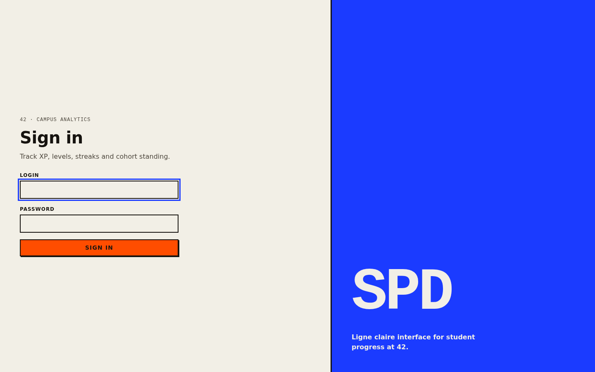
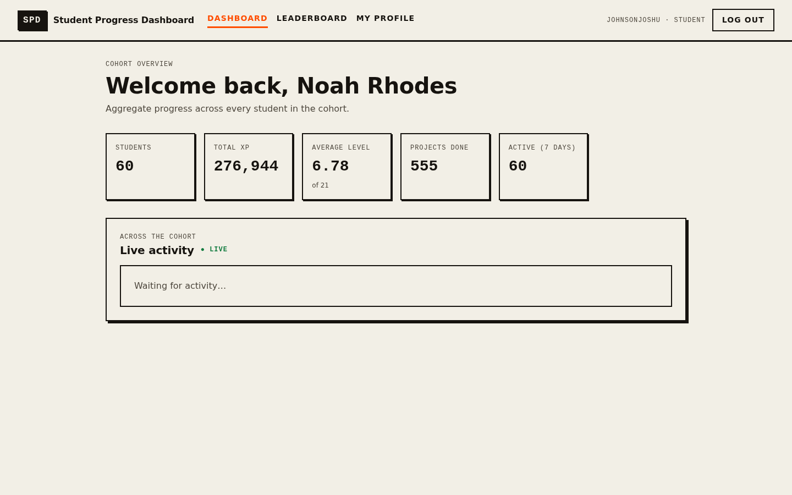
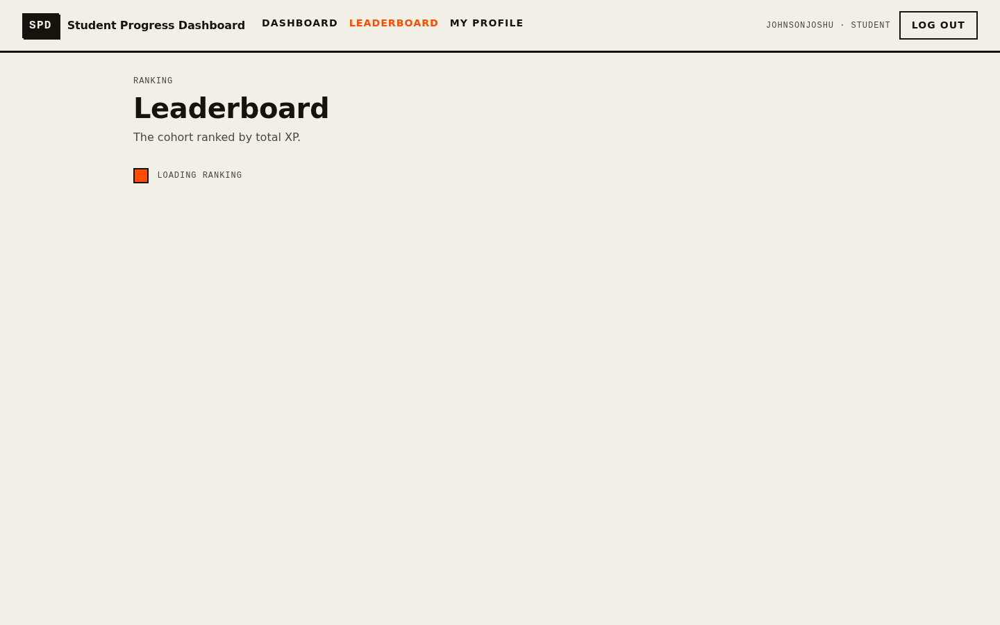
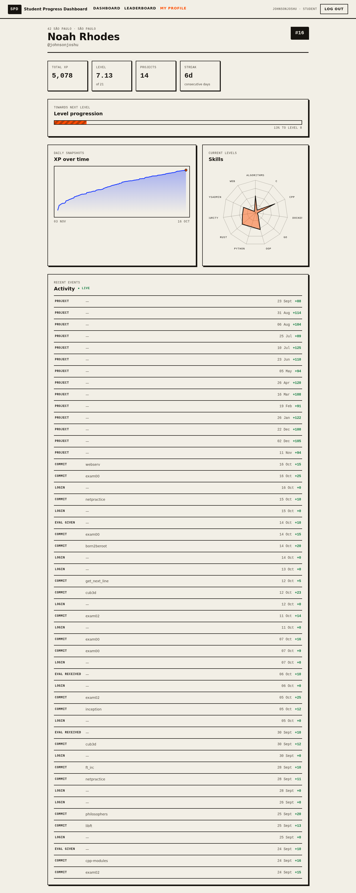

# Student Progress Dashboard

> Full-stack dashboard for tracking student progress — Python/FastAPI + PostgreSQL backend, React 19 + TypeScript frontend, all inside a reproducible NixOS dev environment.

[](../../actions/workflows/ci.yml)

## Status

Complete. The **backend** (phases 1–5) provides the PostgreSQL data layer, JWT
auth and the analytics API with a live SSE stream; the **React frontend**
(phases 6–7) covers sign-in, the cohort dashboard, the leaderboard and the
student profile; **end-to-end tests** (phase 8) exercise the real stack; **CI**
(phase 9) gates every change; and the **docs and release** (phase 10) close it
out. See [docs/architecture.md](docs/architecture.md) for the layering.

This is a portfolio demo, not a production deployment — see
[ADR 0007](docs/adr/0007-scope-and-deployment.md) for what that deliberately
implies.

## Screenshots

| Sign in                                             | Dashboard                                       |
| --------------------------------------------------- | ----------------------------------------------- |
|            |  |
| **Leaderboard**                                     | **Student profile**                             |
|  |      |

## Quickstart (NixOS)

```bash
git clone git@github.com:vde-maga/studentProgressDashboard.git
cd studentProgressDashboard
nix develop          # or: direnv allow
just setup           # deps + git hooks
just db-up           # PostgreSQL via docker compose
just dev             # API :8000 + frontend :5173
```

## Commands

| Command                      | What it does                                     |
| ---------------------------- | ------------------------------------------------ |
| `just help`                  | List all recipes                                 |
| `just setup`                 | Install backend/frontend deps + pre-commit hooks |
| `just dev`                   | Run API + frontend in parallel                   |
| `just test`                  | pytest + vitest                                  |
| `just test-integration`      | Backend integration tests (testcontainers)       |
| `just cov`                   | Backend coverage report (gate ≥80%)              |
| `just test-frontend`         | Frontend unit tests (vitest)                     |
| `just build-frontend`        | Type-check and build the SPA (`frontend/dist`)   |
| `just test-e2e`              | Playwright end-to-end against the real stack     |
| `just screenshots`           | Regenerate the README screenshots                |
| `just lint`                  | ruff, mypy, tsc, eslint                          |
| `just fmt`                   | Format the whole repo (`nix fmt`)                |
| `just db-up` / `db-reset`    | Start / recreate PostgreSQL                      |
| `just migrate` / `just seed` | Alembic migrations / deterministic seed data     |
| `nix flake check`            | Nix checks (formatting, …)                       |

## Authentication

The API uses stateless JWT bearer tokens (Argon2id password hashing):

| Endpoint                    | Description                                     |
| --------------------------- | ----------------------------------------------- |
| `POST /api/v1/auth/login`   | Exchange `login` + `password` for a token pair  |
| `POST /api/v1/auth/refresh` | Exchange a refresh token for a fresh pair       |
| `GET  /api/v1/auth/me`      | Profile of the caller (requires a bearer token) |

Seeded demo accounts all share the password `42cursus!`. See
[ADR 0002](docs/adr/0002-authentication.md) for the design.

## Analytics

Read endpoints for progress data, behind the same bearer auth. Detailed views
are **owner-only**: a student reads their own data, staff/admins read anyone's.

| Endpoint                                | Who            | Returns                          |
| --------------------------------------- | -------------- | -------------------------------- |
| `GET /api/v1/students`                  | staff/admin    | Paged student roster             |
| `GET /api/v1/students/{login}`          | owner or staff | Profile, rank, level progression |
| `GET /api/v1/students/{login}/progress` | owner or staff | Daily XP/level time series       |
| `GET /api/v1/students/{login}/activity` | owner or staff | Recent activity, newest first    |
| `GET /api/v1/students/{login}/skills`   | owner or staff | Skills with current levels       |
| `GET /api/v1/leaderboard`               | authenticated  | Cohort ranked by XP              |
| `GET /api/v1/cohort/summary`            | authenticated  | Aggregate cohort statistics      |
| `GET /api/v1/events/stream`             | authenticated  | Live activity feed (SSE)         |

The stream resends nothing: it is a cursor over activity events, resumable via
`Last-Event-ID`, with periodic heartbeats. Because `EventSource` cannot set an
`Authorization` header, pass the access token as `?token=…`. See
[ADR 0003](docs/adr/0003-analytics-and-sse.md) for the design.

## Frontend

A React 19 + TypeScript SPA (Vite, TanStack Router/Query) styled with a
"ligne claire × brutalism" design system (CSS Modules over shared design
tokens). The UI covers the sign-in flow, an authenticated session with
transparent token refresh, protected routes, the cohort dashboard (aggregate
stats and live cohort activity), the leaderboard, and the student profile —
XP/level, a progress-over-time chart, a skills radar and a live activity feed,
all drawn as hand-built SVG.

```bash
just dev            # API :8000 + Vite :5173 (the SPA proxies /api to the API)
just lint-frontend  # tsc --noEmit + eslint
just test-frontend  # vitest
just build-frontend # production bundle into frontend/dist
just test-e2e       # Playwright (needs `just db-up` first)
```

The dev server proxies `/api` to `http://localhost:8000`, so the browser sees a
same-origin API and no CORS is needed. Point `VITE_API_URL` at a different
origin (via `frontend/.env`) when needed.

End-to-end tests drive the real stack in Chromium: Playwright starts the seeded
API and the Vite server itself (start the database first with `just db-up`).
See [ADR 0004](docs/adr/0004-frontend-foundation.md),
[ADR 0005](docs/adr/0005-profile-charts-and-live-feed.md) and
[ADR 0006](docs/adr/0006-end-to-end-tests.md) for the design.

## Architecture

The backend is laid out as ports-and-adapters (`api → application → domain`,
with `infrastructure` implementing repository protocols); the frontend splits
`app` / `features` / `shared`. Every phase is documented by an ADR. The full
picture, request lifecycle and SSE flow are in
[docs/architecture.md](docs/architecture.md).

## Stack

- **Backend** — Python 3.13, FastAPI, SQLAlchemy 2.0, Alembic, PostgreSQL 17, JWT auth, SSE
- **Frontend** — React 19, TypeScript (strict), Vite, TanStack Router/Query, CSS Modules + design tokens (ligne-claire brutalist UI)
- **Quality** — pytest (+testcontainers), Hypothesis, Vitest, Playwright, ruff, mypy, coverage gate ≥80%
- **DX** — `flake.nix` (devShell, formatter, checks), `just`, `pre-commit`, `uv`, `pnpm`, GitHub Actions

## Repository layout

```
├── flake.nix        # Nix dev environment (toolchain + checks + formatter)
├── justfile         # task runner — start here with `just help`
├── compose.yaml     # PostgreSQL for local dev
├── backend/         # FastAPI app (api / application / domain / infrastructure)
├── frontend/        # React SPA (Vite + TanStack Router/Query + design tokens)
└── docs/            # ADRs (architecture notes and screenshots to come)
```

## License

See [LICENSE](LICENSE).
